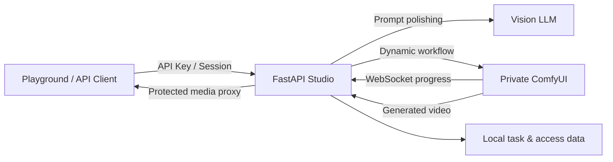

<div align="center">

# MiniMax H3 One-Page Studio

### MiniMax H3 一页式创作台

内置 FL2VA 与 Ref2VA 工作流的独立视频生成服务，集成提示词润色、异步任务、实时进度、私有资源代理和 API Key 管理。


[快速开始](#快速开始) · [ComfyUI 部署](#comfyui-部署) · [配置](#配置) · [API](#api-使用) · [真实示例](#真实生成示例)

</div>

<p align="center">
  
</p>

<p align="center">
  <sub>真实 Ref2VA 结果的 8 秒压缩预览 · <a href="examples/reference_to_video_c3749536/outputs/AI_Video_reference_to_video_20260805_c3749536.mp4">查看带声音的完整 15 秒 MP4</a></sub>
</p>

## 项目亮点

| 能力 | 说明 |
|---|---|
| 一页式创作 | 文本、首帧、末帧、首尾帧和多模态参考生成集中在同一页面 |
| 内置工作流 | 仓库直接提供 MiniMax H3 FL2VA 与 Ref2VA API 工作流 |
| 动态节点图 | 根据输入自动增删图片、视频和音频读取分支 |
| 多模态参考 | 最多 9 张图片、3 个视频、3 个独立音频，可使用视频自带音轨 |
| AI 提示词润色 | 参考图、视频代表帧/480p 动画 GIF 和音频频谱均可作为视觉模型输入 |
| 持久化异步任务 | 支持排队、采样进度、重启恢复、历史回填和结果下载 |
| 后端资源代理 | 前端不接触 ComfyUI 地址、prompt ID 或真实输出路径 |
| 本地访问控制 | 管理员密钥、API Key、浏览器会话、Key 撤销和调用统计 |

## 工作方式



浏览器只保存自己创建的不可预测任务 ID。任务列表接口必须显式提交这些 ID，不会枚举服务端全局历史；唯一例外是管理员（`X-Admin-Key`）可以查看全部任务历史。

访问模式由 `access.mode` 控制：

- `admin`（默认）：管理员单用户模式，无需任何凭据即可直接访问，等同于管理员身份（可查看全部任务历史）。
- `key`：使用管理员密钥或 API Key 验证。
- `register`：任意用户名即可注册使用（无密码），会话保存在浏览器；输入管理员密钥则自动以管理员身份登录。每个用户/密钥只能看到自己创建的任务历史，管理员仍可查看全部。

## 快速开始

### 环境要求

- Python 3.11+
- 可从 API 服务访问的 ComfyUI 实例
- OpenAI/vLLM 兼容的多模态模型服务，用于提示词润色
- FFmpeg 与 FFprobe，用于分析参考视频和音频

### 安装

```powershell
git clone <repository-url>
cd minimax-h3-onepage-studio

python -m venv .venv
.\.venv\Scripts\Activate.ps1
python -m pip install -r requirements.txt
```

### 启动

修改 [`config.yml`](config.yml) 后运行：

```powershell
python -B scripts\check_comfyui.py
python -B run.py
```

本机持续运行（自动检测代码/配置更新并重启，不执行任何 git 操作）可直接双击仓库根目录的 [`start_service.bat`](start_service.bat)；关闭该窗口即停止服务。

默认入口：

| 页面 | 地址 |
|---|---|
| 视频创作 | `http://127.0.0.1:7788/video-generate` |
| 管理控制台 | `http://127.0.0.1:7788/admin-console` |
| API 文档 | `http://127.0.0.1:7788/docs` |
| 健康检查 | `http://127.0.0.1:7788/api/health` |

首次进入：`admin` 模式下无需验证直接使用；`key` 模式下使用管理员密钥完成验证，再通过管理控制台创建有名称和有效期的 API Key。

> [!IMPORTANT]
> `config.yml` 中的管理员密钥仅适合内网首次启动。生产部署必须通过 `SERVICE_ADMIN_KEY` 环境变量覆盖，并使用 HTTPS。

## ComfyUI 部署

项目要求包含 MiniMax H3 原生节点的最新稳定版 ComfyUI。参考：[ComfyUI](https://github.com/comfyanonymous/ComfyUI)、[官方 MiniMax H3 工作流模板](https://github.com/Comfy-Org/workflow_templates/tree/main/templates)、[ComfyUI 服务端路由](https://docs.comfy.org/development/comfyui-server/comms_routes)。

### 官方示例模型

默认配置与当前官方 I2V、T2V、R2V 示例模板一致：扩散模型使用剪枝版 INT8 ConvRot，文本编码器使用 INT8 ConvRot 版本（`qwen3vl_32b_minimax_h3_int8_convrot.safetensors`）。

| 配置项 | 官方示例文件名 | ComfyUI 目录 |
|---|---|---|
| `fl2va_diffusion` | `minimax_h3_fl2va_pruned_int8_convrot.safetensors` | `models/diffusion_models/` |
| `ref2va_diffusion` | `minimax_h3_ref2va_pruned_int8_convrot.safetensors` | `models/diffusion_models/` |
| `nsfw_native_diffusion`（可选） | `PinkCherry_MiniMax_H3_pruned_int8_convrot-beta-0.6.safetensors` | `models/diffusion_models/` |
| `nsfw.fl2v_presets`（可选） | `HMNSFW-AIO-V2.5.safetensors`、`Vagina_minimax-h3_epoch20.safetensors` | `models/loras/` |
| `nsfw.ref2v_presets`（可选） | `AfterMidnight_ref2va_h3_sexytime_rank64-v1.2.safetensors` | `models/loras/` |
| `turbo.fl2v_8step_lora`（可选） | `minimax_h3_fl2v_turbo_8step_v1.0_768p_comfyui_bf16.safetensors` | `models/loras/` |
| `turbo.fl2v_4step_lora`（可选） | `minimax_h3_fl2v_turbo_4step_v1.1_768p_comfyui_bf16.safetensors` | `models/loras/` |
| `turbo.ref2v_4step_lora`（可选） | `minimax_h3_ref2v_turbo_4step_v0.1_comfyui_bf16.safetensors` | `models/loras/` |
| `text_encoder` | `qwen3vl_32b_minimax_h3_int8_convrot.safetensors` | `models/text_encoders/` |
| `video_vae` | `minimax_h3_video_vae_fp16.safetensors` | `models/vae/` |
| `audio_vae` | `minimax_h3_audio_vae_fp32.safetensors` | `models/vae/` |

模型可从 [Comfy-Org/MiniMax-H3](https://huggingface.co/Comfy-Org/MiniMax-H3) 获取；turbo 蒸馏 lora 来自 Minimax-H3-Turbo 官方发布。预期目录：

```text
ComfyUI/models/
├─ diffusion_models/
│  ├─ minimax_h3_fl2va_pruned_int8_convrot.safetensors
│  ├─ minimax_h3_ref2va_pruned_int8_convrot.safetensors
│  └─ PinkCherry_MiniMax_H3_pruned_int8_convrot-beta-0.6.safetensors      # 可选：NSFW 原生基模（fl2v）
├─ loras/
│  ├─ minimax_h3_fl2v_turbo_8step_v1.0_768p_comfyui_bf16.safetensors      # 可选：turbo
│  ├─ minimax_h3_fl2v_turbo_4step_v1.1_768p_comfyui_bf16.safetensors      # 可选：turbo
│  ├─ minimax_h3_ref2v_turbo_4step_v0.1_comfyui_bf16.safetensors          # 可选：turbo
│  ├─ HMNSFW-AIO-V2.5.safetensors                                         # 可选：NSFW（fl2v）
│  ├─ Vagina_minimax-h3_epoch20.safetensors                               # 可选：NSFW（fl2v 叠加）
│  └─ AfterMidnight_ref2va_h3_sexytime_rank64-v1.2.safetensors            # 可选：NSFW（ref2v）
├─ text_encoders/
│  └─ qwen3vl_32b_minimax_h3_int8_convrot.safetensors
└─ vae/
   ├─ minimax_h3_video_vae_fp16.safetensors
   └─ minimax_h3_audio_vae_fp32.safetensors
```

### 必要节点

```text
MiniMaxH3ImageToVideo       MiniMaxH3ReferenceToVideo
LoadImage / ImageScale     LoadVideo / GetVideoComponents
LoadAudio                  CreateVideo / SaveVideo
```

> [!NOTE]
> 采样加速节点 **Spectrum Apply MiniMax H3**（`SpectrumApplyMiniMaxH3`，来自 [ComfyUI-Spectrum-MiniMax-H3](https://github.com/xmarre/ComfyUI-Spectrum-MiniMax-H3)）默认**不启用**。仅在 `comfyui.spectrum_apply.enabled: true` 时 FL2VA 与 Ref2VA 两条**普通**工作流才会串联该节点（turbo 工作流不使用）；此时 ComfyUI 必须安装上述自定义节点；关闭时工作流会完全移除该节点并直接回连模型加载器，**无需安装该依赖**。详见[采样加速](#采样加速spectrum)。

> [!TIP]
> 配置任一 turbo lora 后，工作流还会使用 `MiniMaxH3SigmaShift` 与 `LoraLoaderModelOnly` 节点（均为 ComfyUI 内置）。

启动 ComfyUI 后执行检查：

```powershell
python -B scripts\check_comfyui.py
```

脚本会按照 YAML 验证连接、节点、模型文件和队列接口。ComfyUI 应位于受控内网，仅允许本 API 服务访问。

## 配置

所有必要参数集中在 [`config.yml`](config.yml)：

```yaml
server:
  host: 0.0.0.0
  port: 7788
  admin_key: "admin"

access:
  # admin（默认）= 管理员单用户模式：无需任何凭据，直接以管理员身份访问；
  # key = 密钥模式（管理员/API Key）；register = 注册模式（用户名即注册，无密码）
  mode: "admin"

comfyui:
  base_url: "http://127.0.0.1:8188"
  timeout_seconds: 60
  models:
    fl2va_diffusion: "minimax_h3_fl2va_pruned_int8_convrot.safetensors"
    ref2va_diffusion: "minimax_h3_ref2va_pruned_int8_convrot.safetensors"
    # 原生 NSFW 基模档位（可选；仅 fl2v 家族，与 LoRA 档位二选一互斥）
    nsfw_native_diffusion: "PinkCherry_MiniMax_H3_pruned_int8_convrot-beta-0.6.safetensors"
    text_encoder: "qwen3vl_32b_minimax_h3_int8_convrot.safetensors"
    video_vae: "minimax_h3_video_vae_fp16.safetensors"
    audio_vae: "minimax_h3_audio_vae_fp32.safetensors"
  # 采样加速（默认不启用）
  spectrum_apply:
    enabled: false
  # NSFW LoRA 配方（可选；配置后前端出现 NSFW 档位下拉，LoRA 档位与 turbo 互斥）
  nsfw:
    fl2v_presets:
      - id: "aio"
        label: "AIO 1.0"
        loras: [{lora: "HMNSFW-AIO-V2.5.safetensors", strength: 1.0}]
    ref2v_presets: []
  # Turbo 蒸馏 lora（可选；配置后分辨率下拉出现 turbo 档位）
  turbo:
    fl2v_8step_lora: "minimax_h3_fl2v_turbo_8step_v1.0_768p_comfyui_bf16.safetensors"
    fl2v_8step_shift: "12,3"
    fl2v_4step_lora: "minimax_h3_fl2v_turbo_4step_v1.1_768p_comfyui_bf16.safetensors"
    fl2v_4step_shift: "6,3"
    ref2v_4step_lora: "minimax_h3_ref2v_turbo_4step_v0.1_comfyui_bf16.safetensors"
    ref2v_4step_shift: "12,3"

llm:
  base_url: "http://127.0.0.1:8000/v1"
  api_key: ""
  model: "vision-model"
  reasoning_effort: "low"  # low / medium / high；留空则不发送（回退 enable_thinking=false）

ffmpeg:
  path: ""  # ffmpeg.exe 绝对路径；留空则 GIF 下载不显示、润色回退为代表帧、参考视频原样上传

video:
  duration: {default: 5, min: 5, max: 15}
  resolution_megapixels: {default: 0.4, min: 0.2, max: 1.0}
```

相对数据目录以仓库根目录解析。也可以通过 `VIDEO_SERVICE_CONFIG` 指向外部 YAML：

```powershell
$env:VIDEO_SERVICE_CONFIG = 'D:\config\minimax-h3-studio.yml'
```

> [!IMPORTANT]
> **`config.yml` 已被 `.gitignore` 忽略，不会提交到版本库**——所有配置（包括 API Key、管理员密钥、本机 ffmpeg 路径、部署开关等私有项）统一写在 `config.yml`。仓库内仅提供 [`config.example.yml`](config.example.yml) 作为默认值范例：新环境复制它为 `config.yml` 后按需修改即可。提交前请用 `git grep` 检查敏感信息（例如 `git grep -n "sk-\|api_key"`）。

生产环境常用覆盖项：

| 环境变量 | 用途 |
|---|---|
| `SERVICE_ADMIN_KEY` | 管理员密钥 |
| `COMFYUI_BASE_URL` | ComfyUI 地址 |
| `LLM_BASE_URL` / `LLM_API_KEY` / `LLM_MODEL` | 润色模型配置 |
| `COMFYUI_FL2VA_MODEL` / `COMFYUI_REF2VA_MODEL` | 两个扩散模型文件名 |
| `COMFYUI_TEXT_ENCODER` | 文本编码器文件名 |
| `COMFYUI_VIDEO_VAE` / `COMFYUI_AUDIO_VAE` | VAE 文件名 |
| `COMFYUI_SPECTRUM_ENABLED` | 采样加速开关（true/false） |
| `COMFYUI_TURBO_FL2V_8STEP_LORA` / `COMFYUI_TURBO_FL2V_4STEP_LORA` / `COMFYUI_TURBO_REF2V_4STEP_LORA` | turbo 蒸馏 lora 文件名（留空禁用对应档位） |
| `LLM_REASONING_EFFORT` | 思考模式力度（low/medium/high，留空不发送） |
| `FFMPEG_PATH` | ffmpeg 可执行文件路径（GIF 转换） |
| `VIDEO_DATA_FOLDER` / `ACCESS_DATA_FOLDER` | 运行时数据目录 |

`/api/config` 只返回前端需要的视频参数与 `ffmpeg_enabled`，不包含 ComfyUI、LLM 或密钥信息。

## 内置工作流

### FL2VA：文本与参考帧生成

[`video_workflows/video_api.json`](video_workflows/video_api.json) 统一处理四种输入：

- 无图片：文本生成视频
- 仅首帧或仅末帧：保留对应图像分支
- 首帧 + 末帧：同时约束开头与结尾
- 自动比例：首帧 → 末帧 → 16:9

### Ref2VA：多模态参考生成

[`video_workflows/reference_video_api.json`](video_workflows/reference_video_api.json) 根据上传内容动态创建图片、视频与音频读取分支。自动比例优先使用第一张参考图，否则使用 16:9。

`ref_image_size` 支持：

- `match`：匹配生成分辨率，默认且速度更快
- `max`：最高身份保真，参考 token 参与每一步采样，耗时显著增加

### Turbo 模板（蒸馏加速）

[`video_workflows/video_turbo_api.json`](video_workflows/video_turbo_api.json) 与 [`video_workflows/reference_video_turbo_api.json`](video_workflows/reference_video_turbo_api.json) 为 turbo 蒸馏模板，仅在分辨率下拉选中 turbo 档位时使用，与普通模板的差别：

- 基模输出串接 `LoraLoaderModelOnly`（lightx2v 蒸馏 lora，仅 model 不作用 clip）与 `MiniMaxH3SigmaShift`（shift_video / shift_audio 按 lora 官方值注入），采样步数直接设为蒸馏步数（**不跳步**）。
- 不串联 Spectrum 采样加速节点；其余接线（模型注入、素材分支裁剪、参考素材挂载、输出前缀）与普通模板一致。
- 运行时注入项：lora 文件名与档位、shift 值、steps、分辨率/时长/种子；NSFW 档位不注入（与 turbo 互斥）。

## 采样加速（Spectrum）

两条工作流（FL2VA 与 Ref2VA）都内置了可选的采样加速节点 **Spectrum Apply MiniMax H3**（`SpectrumApplyMiniMaxH3`），接线方式为：模型加载器 → Spectrum 节点 → 调度器/引导器。

| 配置 | 行为 |
|---|---|
| `comfyui.spectrum_apply.enabled: false`（默认） | 构建工作流时**移除**该节点，模型直接连回加载器；ComfyUI 无需安装任何额外依赖 |
| `comfyui.spectrum_apply.enabled: true` | 工作流串联该节点；ComfyUI 必须安装 [ComfyUI-Spectrum-MiniMax-H3](https://github.com/xmarre/ComfyUI-Spectrum-MiniMax-H3)（节点位于 `sampling/spectrum`） |

依赖安装（仅启用时需要）：

```powershell
cd ComfyUI/custom_nodes
git clone https://github.com/xmarre/ComfyUI-Spectrum-MiniMax-H3.git
# 重启 ComfyUI
```

Spectrum 通过对隐藏特征做 Chebyshev 岭回归预测来跳过部分 transformer 评估，从而加速采样，属于近似加速而非无损执行；`enabled` 关闭时原生逐帧采样。注意 README 顶部的示例 Gif 与安全建议：加速会改变去噪轨迹，质量敏感场景请同种子对比。

## Turbo 蒸馏档位（分辨率联动）

分辨率下拉框顶部为 turbo 蒸馏档位（lightx2v lora），**选中对应分辨率即选用对应 turbo 工作流与步数**；下方保留原有普通档位（0.2～1.0 MP，沿用原工作流）。默认选中 `0.5（6step）`。

**FL2V 家族**（文生视频 / 首帧 / 尾帧 / 首尾帧共享配置，[`video_workflows/video_turbo_api.json`](video_workflows/video_turbo_api.json)）：

| 分辨率档位 | 任务参数 `resolution_preset` | lora | shift（video/audio） | 步数 |
|---|---|---|---|---|
| `0.5（6step）`（默认） | `turbo-0.5-6` | `fl2v_8step_lora` | 12 / 3 | 6 |
| `0.5（8step）` | `turbo-0.5-8` | `fl2v_8step_lora` | 12 / 3 | 8 |
| `1.0（4step）` | `turbo-1.0-4` | `fl2v_4step_lora`（768p） | 6 / 3 | 4 |

**Ref2V 家族**（多模态参考生成，[`video_workflows/reference_video_turbo_api.json`](video_workflows/reference_video_turbo_api.json)）：`0.5（4step）` / `0.5（6step）` / `0.5（8step）` 三档（`turbo-0.5-4` / `turbo-0.5-6` / `turbo-0.5-8`）**共用同一个** `ref2v_4step_lora`（shift 12 / 3），仅步数不同。

实现要点：

- 步数直接写入 `BasicScheduler.steps`，`MiniMaxH3SigmaShift` 按步数重建对应 sigma 网格，**不做任何跳步 / sigma 子集处理**。
- turbo 工作流不串联 Spectrum 采样加速节点（蒸馏模型本身只需 4~8 步）。
- **NSFW LoRA 与 turbo 互斥**：NSFW LoRA 与 turbo 蒸馏 LoRA 不能叠加。选中 LoRA 档位后前端只保留普通分辨率档位；接口同时传 `nsfw=true` + `nsfw_preset=<lora 档位>` 与 `turbo-*` 档位返回 400。
- **原生基模档位例外**：fl2v 的「原生基模」档位（`nsfw_preset=native`）不挂 LoRA，可与 turbo 组合（蒸馏 lora 直接作用于原生 NSFW 基模）。
- 某个 lora 文件名留空即禁用对应档位（前端不渲染该选项，接口传参返回 400）；`scripts/check_comfyui.py` 会校验已配置的 turbo lora 文件存在。

## NSFW 档位（LoRA 配方 + 原生基模）

NSFW 有两种互斥的实现，前端下拉里二选一：

1. **NSFW LoRA 档位**：配置在 `comfyui.nsfw` 下按模式分组，每个档位可叠加多个 LoRA（按配置顺序串联在基模之后，各自带强度）：
2. **原生基模档位**（仅 fl2v 家族，`id=native`）：`comfyui.models.nsfw_native_diffusion` 指定模型，选中后直接替换 UNETLoader 基模、不挂任何 LoRA。

```yaml
comfyui:
  models:
    # 原生基模档位（仅 fl2v 家族；与 LoRA 档位二选一互斥，可与 turbo 组合；留空则该档位不出现）
    nsfw_native_diffusion: "PinkCherry_MiniMax_H3_pruned_int8_convrot-beta-0.6.safetensors"
  nsfw:
    fl2v_presets:          # 文生视频 / 首帧 / 尾帧 / 首尾帧
      - id: "aio"
        label: "AIO 1.0"
        loras:
          - {lora: "HMNSFW-AIO-V2.5.safetensors", strength: 1.0}
      - id: "aio-vagina"
        label: "AIO 0.65 + Vagina 0.35"
        loras:
          - {lora: "HMNSFW-AIO-V2.5.safetensors", strength: 0.65}
          - {lora: "Vagina_minimax-h3_epoch20.safetensors", strength: 0.35}
    ref2v_presets:         # 多模态参考生成（不支持原生基模档位）
      - id: "aftermidnight"
        label: "AfterMidnight 1.0"
        loras:
          - {lora: "AfterMidnight_ref2va_h3_sexytime_rank64-v1.2.safetensors", strength: 1.0}
```

| 任务参数 | 行为 |
|---|---|
| `nsfw=false`（默认） | 常规 fl2v / ref2v 基模，不挂任何 LoRA |
| `nsfw=true` + `nsfw_preset=<id>` | 按该档位串联 LoRA（`UNET → Lora → … → Spectrum/调度器`），润色注入 NSFW 风格指南 |
| `nsfw=true` + `nsfw_preset=native`（仅 fl2v） | UNETLoader 基模替换为原生 NSFW 模型，不挂 LoRA，可与 turbo 组合 |
| `nsfw=true` 且 `nsfw_preset` 留空 | 回落该模式第一个 LoRA 档位（历史任务兼容；旧参数 `nsfw_native=true` 回落为 native 档位） |

接线与约束：

- fl2v 档位的 LoRA 链从节点 `151` 起（`152`、`153`… 依次叠加），ref2v 从 `144` 起；关闭 Spectrum 时直接回连调度器/引导器。
- 两个分组互不影响：fl2v 档位只作用于文/首帧/尾帧/首尾帧，ref2v 档位只作用于多模态参考。
- **LoRA 档位与 turbo 互斥**：蒸馏 LoRA 与 NSFW LoRA 不可叠加，选中 LoRA 档位时 turbo 档位不渲染，接口组合传参返回 400；「原生基模」档位（native）例外，可与 turbo 组合。
- LoRA 文件需位于 ComfyUI `models/loras/` 目录、原生基模位于 `models/diffusion_models/`（`scripts/check_comfyui.py` 会校验）；某模式未配置任何档位时前端不渲染 NSFW 下拉，接口传 `nsfw=true` 返回 400。
- 前端下拉选项由 `/api/config` 的 `nsfw_presets` 提供（fl2v 末尾的 `native` 项即原生基模档位），改配置（增删档位、调强度、换基模）重启后即可生效，无需改代码。
- 历史记录兼容：旧参数 `nsfw_strength`（>0）回落为 `nsfw=true`（开启 + 默认 LoRA 档位）；`nsfw_native=true` 在 fl2v 家族回落为 native 档位（ref2v 回落默认 LoRA 档位）；历史任务回填时同样按此规则显示。

## 视频转 GIF 下载

配置 `ffmpeg.path`（ffmpeg.exe 绝对路径，或安装 `pip install imageio-ffmpeg` 后使用其自带静态二进制）后，前端详情页会对已完成视频显示「下载 GIF」按钮，服务端使用 palette 方式将视频转为 ≤480px 的循环 GIF 并缓存：

```http
GET /api/video/tasks/{task_id}/gif
```

`ffmpeg.path` 留空时该接口返回 404，前端也不显示 GIF 按钮。

配置 ffmpeg 后，多模态参考模式（ref2v）还有两个增强行为：

- **润色参考**：参考视频会先转成 ≤480px、10fps 的动画 GIF 喂给润色模型作为「视频参考信息」（未配置 ffmpeg 时回退为抽取 3 张代表帧）。
- **生成参考**：提交给视频生成模型的参考视频仍保持视频格式，但会先用 ffmpeg 重编码到与输出分辨率一致的大小和帧率（等比放大覆盖后居中裁剪、帧率对齐目标帧数/时长），保证参考帧数与目标时长对齐并降低 ComfyUI 端负载；压缩失败时自动回退为原视频。

## API 使用

所有视频接口均需要 API Key、管理员密钥或已验证的浏览器会话（`admin` 模式下无需任何凭据）：

```http
X-API-Key: dc_xxx
Authorization: Bearer dc_xxx
X-Admin-Key: your-admin-secret
```

### 创建文本/参考帧任务

```bash
curl -X POST http://127.0.0.1:7788/api/video/tasks \
  -H "X-API-Key: dc_xxx" \
  -F "prompt=A cinematic rainy railway platform" \
  -F "duration=5" \
  -F "resolution_megapixels=0.4" \
  -F "resolution_preset=turbo-0.5-6" \
  -F "aspect_ratio=auto" \
  -F "polish_prompt_first=true" \
  -F "first_frame=@first.png"
```

`resolution_preset` 可选：留空走普通工作流（使用 `resolution_megapixels`）；fl2v 支持 `turbo-0.5-6` / `turbo-0.5-8` / `turbo-1.0-4`（详见上文「Turbo 蒸馏档位」）。

`nsfw` 可选布尔值（默认 `false`），配合 `nsfw_preset=<id>` 选择 NSFW 档位（详见「NSFW 档位（LoRA 配方 + 原生基模）」）：

```bash
  -F "nsfw=true" \
  -F "nsfw_preset=aio-vagina" \
```

`nsfw_preset` 取 `/api/config` 的 `nsfw_presets.fl2v` 中的 id：LoRA 档位（如 `aio` / `aio-vagina`）与 `resolution_preset`（turbo）**互斥**，同时传参会返回 400；`native`（原生基模档位）不挂 LoRA，可与 turbo 组合。旧参数 `nsfw_strength > 0` 视为开启（回落默认 LoRA 档位）；`nsfw_native=true` 回落为 `native` 档位。

### 创建多模态参考任务

```bash
curl -X POST http://127.0.0.1:7788/api/video/reference-tasks \
  -H "X-API-Key: dc_xxx" \
  -F "prompt=Create a coherent cinematic sequence" \
  -F "duration=10" \
  -F "resolution_megapixels=0.4" \
  -F "resolution_preset=turbo-0.5-8" \
  -F "aspect_ratio=auto" \
  -F "polish_prompt_first=true" \
  -F "ref_image_size=match" \
  -F "reference_images=@character.png" \
  -F "reference_videos=@motion.mp4" \
  -F "reference_audios=@music.wav"
```

注意：参考生成接口的 turbo 档位为 `turbo-0.5-4` / `turbo-0.5-6` / `turbo-0.5-8`（共用同一 lora，仅步数不同）；`nsfw` 同样接受并叠加 `nsfw_presets.ref2v` 的 LoRA 档位（不替换 Ref2VA 基模），与 turbo 档位互斥。

### 查询进度与结果

```bash
curl -H "X-API-Key: dc_xxx" \
  http://127.0.0.1:7788/api/video/tasks/{task_id}
```

同一个接口返回状态、进度、阶段、排队位置和结果。完成后 `assets.video` 是受保护的本服务代理地址。全部接口和字段约束请查看 `/docs`。

## 真实生成示例

该示例使用四张参考图生成一段 15 秒、1280 × 736、带声音的视频。

<table>
  <tr>
    <td align="center"><br><code>&lt;Picture 1&gt;</code></td>
    <td align="center"><br><code>&lt;Picture 2&gt;</code></td>
    <td align="center"><br><code>&lt;Picture 3&gt;</code></td>
    <td align="center"><br><code>&lt;Picture 4&gt;</code></td>
  </tr>
</table>

<p align="center">
  <strong>生成结果</strong><br><br>
  
</p>

| 参数 | 值 |
|---|---|
| 工作流 | `reference_to_video` |
| 时长 | 15 秒 |
| 输出 | 1280 × 736 / 0.9 MP / 16:9 |
| 参考保真度 | `max` |
| 任务 ID | `c37495363d3b448ea9187e320e3c28b8` |

- [完整 MP4（含声音）](examples/reference_to_video_c3749536/outputs/AI_Video_reference_to_video_20260805_c3749536.mp4)
- [请求参数](examples/reference_to_video_c3749536/request.json)
- [最终提示词](examples/reference_to_video_c3749536/prompt.txt)
- [结果摘要](examples/reference_to_video_c3749536/result.json)

`prompt.txt` 已是润色后的最终提示词，因此示例请求使用 `polish_prompt_first=false`，避免二次润色造成漂移。

## 安全与数据维护

- 输入、输出和下载全部通过已认证的 API 代理。
- 客户端无法获得 ComfyUI 地址、prompt ID 或真实文件路径。
- 历史接口按身份隔离：每个 API Key/注册用户只能看到自己创建的任务，管理员可查看全部。
- API Key、调用统计和任务文件均维护在部署机器本地。
- 默认保留终态任务 90 天，每周日 03:00 清理。
- 每天 00:05 检查磁盘；占用达到 90% 时从最旧终态任务开始清理。
- 润色中、准备中、排队中和运行中的任务不会被自动清理。

## 验证

```powershell
# 自动化测试
python -B -m pytest -q

# 应用导入
python -B -c "import main; print(main.app.title)"

# ComfyUI 节点、模型与队列
python -B scripts\check_comfyui.py
```
